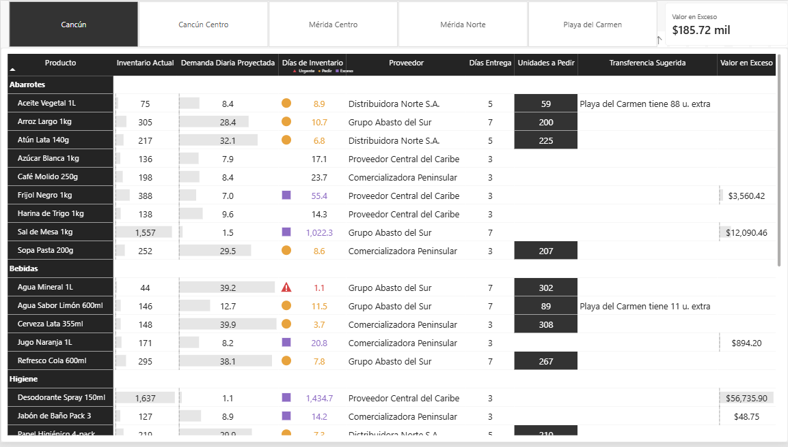

# Análisis de Rotación de Inventario



Una distribuidora con cinco sucursales en Cancún, Playa del Carmen y Mérida hacía sus pedidos a ojo: se le acababan los productos que más se venden y acumulaba los que casi no se mueven. Limpié 18 meses de ventas e inventario diario en Python, comparé 11 métodos de proyección contra las ventas reales de 2024 y elegí una mezcla de promedios móviles con índice estacional. La repliqué en Power BI con DAX junto con las reglas de negocio. El resultado es un tablero que dice por producto y sucursal si hay que pedir, cuánto y a qué proveedor, dónde hay dinero parado en exceso y qué sucursal puede transferir mercancía antes de comprar

→ **[Caso completo en Notion](https://app.notion.com/p/An-lisis-de-Rotaci-n-de-Inventario-392b7682d7a7804c9e7de903430dbc3b)**

---

Estructura del proyecto:

```
analisis-rotacion-inventario-distribuidora/
│
├── data/
│   ├── _raw/
│   │   └── inventario_demanda.csv              # Ventas e inventario diario por producto y sucursal
│   └── processed/
│       └── inventario_demanda_limpio.parquet   # Datos limpios
│
├── notebooks/
│   ├── 01_data_cleaning.ipynb                  # Limpieza y estandarización
│   ├── 02_eda.ipynb                            # Ventas por sucursal, día de la semana y mes
│   └── 03_proyeccion.ipynb                     # Comparación de 11 métodos de proyección
│
└── reports/
    ├── inventario.pbix                         # Dashboard de Power BI
    ├── inventario.png                          # Captura del dashboard
    └── Documentacion_Modelo_Inventario.docx    # Tablas, medidas y reglas de negocio
```
