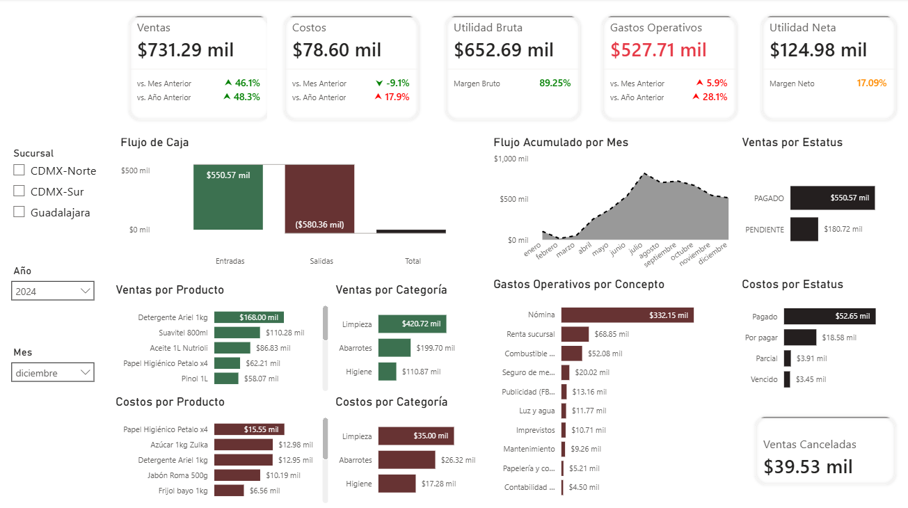

# Dashboard de análisis financiero para distribuidor mayorista



Un distribuidor de abarrotes con tres sucursales recibía su información financiera hasta el día 20 del mes siguiente, con datos dispersos en tres fuentes sin formato común. Perfilé y limpié los datos con Python y Power Query, modelé un esquema estrella con medidas DAX centralizadas y diseñé plantillas Excel con validación para estandarizar la captura. El resultado es un dashboard en Power BI con P&L simplificado, flujo de caja, márgenes por sucursal y comparativas mes a mes y año a año, que da visibilidad diaria del negocio

→ **[Caso completo en Notion](https://app.notion.com/p/Dashboard-de-an-lisis-financiero-para-distribuidor-mayorista-365b7682d7a780808311d39841913f80)**

---

Estructura del proyecto:

```
dashboard-finanzas-sucursales/
│
├── data/
│   ├── _raw/                          # Archivos originales del cliente
│   │   ├── ventas_CDMX_aspel_export.xlsx
│   │   ├── ventas_GDL_lupita_manual.xlsx
│   │   ├── gastos_operativos_dueño.xlsx
│   │   └── compras_proveedores.xlsx
│   │
│   └── processed/                     # Plantillas limpias y estandarizadas
│       ├── ventas_CDMX.xlsx
│       ├── ventas_GDL.xlsx
│       ├── gastos_operativos_CDMX_Norte.xlsx
│       ├── gastos_operativos_CDMX_Sur.xlsx
│       ├── gastos_operativos_Guadalajara.xlsx
│       └── presupuestos.xlsx
│
├── notebooks/
│   └── clean_data.ipynb               # Perfilado y limpieza de datos
│
└── reports/
    └── dashboard_dist_rojas_hermanos.pbix
```
